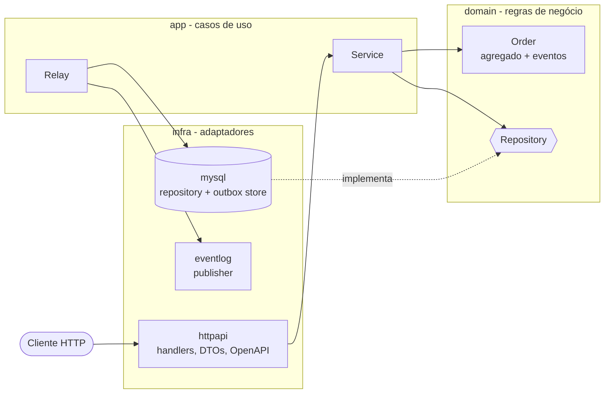

# Stockly

[](https://github.com/codEvil1/stockly/actions/workflows/ci.yml)

API de pedidos em **Go** com **MySQL**, construída para demonstrar práticas usadas em serviços de produção: arquitetura hexagonal por feature, regras de negócio isoladas no domínio, eventos via *transactional outbox*, idempotência, concorrência otimista, observabilidade básica e CI.

## Destaques

- **Domínio rico e testável:** o agregado `Order` protege as próprias invariantes (limites, SKU único, transições de status) e emite eventos de domínio.
- **Transactional outbox:** eventos são gravados na mesma transação do pedido e publicados por um relay com `FOR UPDATE SKIP LOCKED`.
- **Criação idempotente:** header `Idempotency-Key` com índice `UNIQUE`, seguro contra retries e corridas.
- **Concorrência otimista:** transições com `UPDATE ... WHERE status = ?` retornam `409` em vez de sobrescrever.
- **Operação:** `/healthz` (liveness), `/readyz` (readiness com ping no banco), logs JSON estruturados com `request_id`, *graceful shutdown*, container não-root.
- **Qualidade:** testes unitários, de handler HTTP e de integração contra MySQL real; CI com lint, `-race`, integração e build do Docker.

## Arquitetura

Hexagonal (*ports & adapters*) organizada por feature. As dependências sempre apontam para dentro.



### Fluxo de eventos (outbox)

```mermaid
sequenceDiagram
    participant C as Cliente
    participant API as API (Service)
    participant DB as MySQL
    participant R as Relay
    participant B as Broker (log hoje)

    C->>API: POST /orders
    API->>DB: BEGIN; INSERT order, items, outbox; COMMIT
    API-->>C: 201 Created
    loop a cada 2s
        R->>DB: SELECT ... WHERE published_at IS NULL FOR UPDATE SKIP LOCKED
        R->>B: Publish(event)
        R->>DB: UPDATE outbox SET published_at
    end
```

### Estrutura de pastas

```
cmd/api/                  # composition root: só conecta as peças
internal/
  orders/
    domain/               # Order, regras, erros, interface Repository
    app/                  # Service (casos de uso) e Relay do outbox
    infra/
      httpapi/            # handlers, OpenAPI embutido, Swagger UI
      mysql/              # repositório e store do outbox
      eventlog/           # Publisher que escreve em log
  platform/               # config, conexão com o banco, servidor HTTP
migrations/               # SQL versionado (golang-migrate)
docs/adr/                 # decisões de arquitetura
```

As decisões e seus trade-offs estão em [`docs/adr`](docs/adr/README.md).

## Como rodar

Pré-requisitos: Docker (com Compose v2) e, para desenvolvimento local, Go (versão do `go.mod`).

```bash
make up        # MySQL + migrations + API em http://localhost:8080
make logs      # acompanha os logs
make down      # derruba tudo e apaga o volume
```

Documentação interativa: <http://localhost:8080/docs> (a UI do Swagger vem de um CDN) e o contrato em <http://localhost:8080/openapi.yaml>.

Para desenvolver sem containerizar a API:

```bash
docker compose up -d --wait mysql && make migrate-up
make run
```

`make help` lista todos os comandos.

## Exemplos

```bash
# Criar pedido (a mesma Idempotency-Key devolve o mesmo pedido, com 200)
curl -i -X POST localhost:8080/orders \
  -H 'Idempotency-Key: pedido-123' \
  -d '{"customer_id":"cust-1","items":[{"sku":"SKU-001","quantity":2,"price_cents":1000}]}'

# Buscar, listar (paginado, mais recentes primeiro) e mudar status
curl localhost:8080/orders/<id>
curl 'localhost:8080/orders?customer_id=cust-1&limit=10&offset=0'
curl -X POST localhost:8080/orders/<id>/complete   # ou /cancel
```

| Método | Rota | Descrição | Respostas |
|--------|------|-----------|-----------|
| POST | `/orders` | Cria pedido (`Idempotency-Key` opcional) | 201, 200 (replay), 400 |
| GET | `/orders` | Lista com `customer_id`, `limit` (máx. 100), `offset` | 200, 400 |
| GET | `/orders/{id}` | Busca por ID | 200, 400, 404 |
| POST | `/orders/{id}/complete` | `CREATED → COMPLETED` | 200, 404, 409 |
| POST | `/orders/{id}/cancel` | `CREATED → CANCELED` | 200, 404, 409 |
| GET | `/healthz`, `/readyz` | Liveness e readiness | 200, 503 |

## Testes

```bash
make test               # unitários + handlers, com -race
make test-integration   # sobe o MySQL, aplica migrations e testa o SQL de verdade
make cover              # relatório de cobertura em coverage.html
make lint               # golangci-lint
```

| Camada | Como é testada |
|--------|----------------|
| `domain` | Testes de tabela das regras, transições e eventos |
| `app` | Fakes em memória: idempotência, corrida na chave, paginação, relay |
| `httpapi` | `httptest` de ponta a ponta (handler → service → domínio) |
| `mysql` | Integração com MySQL 8 real (`-tags integration`) |

## Configuração

Todas por variável de ambiente; veja [`.env.example`](.env.example) para a lista completa com os defaults. As principais: `DB_DSN` (obrigatoriamente com `parseTime=true`), `HTTP_ADDR`, `OUTBOX_POLL_INTERVAL`, `LOG_LEVEL`.

## Próximos passos

- [ ] Publisher real (Kafka ou SQS) no lugar do `eventlog`, com consumidores idempotentes.
- [ ] Rotina de limpeza do outbox e das chaves de idempotência antigas.
- [ ] Validar o hash do corpo junto com a `Idempotency-Key`.
- [ ] Paginação por cursor (*keyset*) no lugar de `OFFSET`.
- [ ] Autenticação e autorização.
- [ ] Métricas (Prometheus) e tracing (OpenTelemetry).
- [ ] Segunda feature (ex.: `inventory`) reaproveitando a mesma estrutura.
